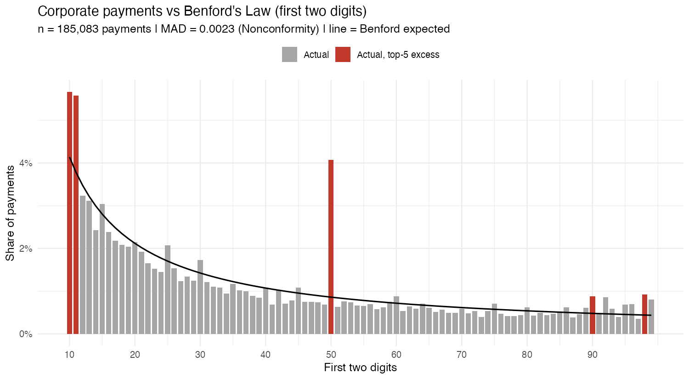

# Benford Audit Check (R)

**Question:** Do a company's vendor payments follow Benford's Law, and if not, which payments should an auditor look at first?

## Data
`corporate.payment` from the [`benford.analysis`](https://cran.r-project.org/package=benford.analysis) R package: 189,470 payments to 26,166 vendors in 2010 (real, anonymized data from a US utility, used by Nigrini). No download needed.

## Method
1. **First-two-digit test** on all payments of at least 10 (185,083 payments).
2. **Conformity:** Mean Absolute Deviation (MAD) against Nigrini's (2012) first-two-digit thresholds, plus a Pearson chi-square test. With this many observations, chi-square rejects almost any real data, so MAD is the main measure.
3. **Top 20 suspicious payments:** payments are grouped by vendor and amount. Each group gets one point per red flag:
   - its first two digits are among the 5 most over-represented
   - the same vendor was paid the same amount more than once (duplicate)
   - the amount is round (a multiple of 100)

   Groups are ranked by score, then by total amount paid.

## Findings


| Payments tested | MAD | Conformity | Chi-square (df 89) | p-value |
|---|---|---|---|---|
| 185,083 | 0.00234 | **Nonconformity** (> 0.0022) | 32,094 | < 1e-16 |

- The payments **do not conform** to Benford's Law. The biggest spike is at **50**: 7,530 payments against about 1,590 expected. Most of it comes from a single amount, **$50.00, which was paid 6,022 times**, likely a fixed fee or reimbursement policy that should be explained.
- **10** and **11** are also heavily over-represented (about 10,400 payments each against roughly 7,000 to 7,700 expected), and so are **90** and **98**, which fits prices set just below a threshold.
- The top 20 list ([`output/top20_suspicious_payments.csv`](output/top20_suspicious_payments.csv)) is led by repeated round payments of **$500,000 and $1,000,000**. For example, vendor 16721 received $500,000 14 times ($7M in total), and vendor 14728 received $500,000 9 times. All 20 groups hit all three red flags and are the first candidates for invoice and approval testing.

A Benford deviation is a reason to look closer, not proof of fraud. Recurring fees, contract installments and pricing policies all create legitimate spikes.

## Run
```r
install.packages(c("benford.analysis", "dplyr", "ggplot2"))
source("analysis.R")   # from the project root; writes everything to output/
```

| Output | Content |
|---|---|
| `output/benford_first_two_digits.png` | actual vs expected distribution |
| `output/benford_summary.csv` | MAD, conformity, chi-square |
| `output/top20_suspicious_payments.csv` | ranked suspicious vendor and amount groups |
